<h1 align="center">Have fun at code 👋</h1>

  Kotlin · Java · Spring으로 일하는 백엔드 개발자입니다. 
  JVM 생태계 오픈소스에 버그 수정과 개선 PR을 보내고 있습니다.

  <a href="https://havefunatcode.github.io/">포트폴리오</a> ·
  <a href="https://github.com/pulls?q=is%3Apr+author%3Ahavefunatcode+is%3Apublic">보낸 PR 전체</a>

## 오픈소스 기여

| 프로젝트 | 내용 |
| --- | --- |
| [apache/druid](https://github.com/apache/druid) | [SUM·AVG 등 숫자 집계 함수에서 숫자가 아닌 문자열 리터럴 거부 (#20845)](https://github.com/apache/druid/pull/20845) |
| [apache/druid](https://github.com/apache/druid) | [quantile 집계 함수의 첫 번째 피연산자 검증 (#20782)](https://github.com/apache/druid/pull/20782) |
| [OpenFeign/feign](https://github.com/OpenFeign/feign) | [QueryMap POJO의 필드·getter에 `@Param` expander 적용 (#3658)](https://github.com/OpenFeign/feign/pull/3658) |
| [mockk/mockk](https://github.com/mockk/mockk) | [sealed value class 하위 타입에 서로 다른 signature 값 부여 (#1581)](https://github.com/mockk/mockk/pull/1581) |

리뷰 중인 PR은 [여기](https://github.com/pulls?q=is%3Apr+author%3Ahavefunatcode+is%3Aopen+is%3Apublic)에서 볼 수 있습니다.

## GitHub 활동

  <picture>
    <source media="(prefers-color-scheme: dark)" srcset="./profile/stats-dark.svg" />
    
  </picture>
  <picture>
    <source media="(prefers-color-scheme: dark)" srcset="./profile/top-langs-dark.svg" />
    
  </picture>

  <picture>
    <source media="(prefers-color-scheme: dark)" srcset="./profile/snake-dark.svg" />
    
  </picture>

